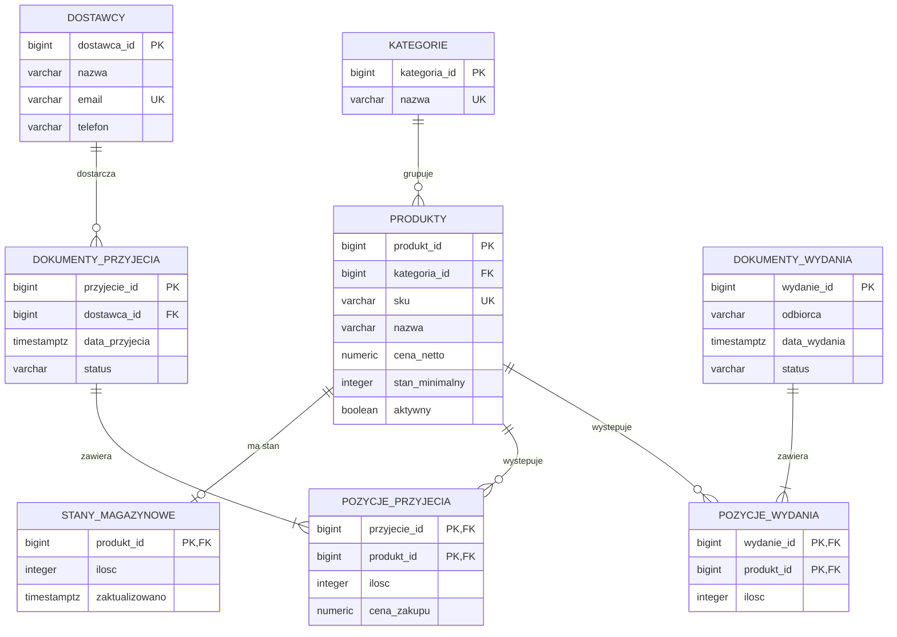

# Diagram ERD — system magazynowy

Diagram przedstawia strukturę relacyjnej bazy danych systemu magazynowego w PostgreSQL. Pokazuje tabele, klucze główne (PK), klucze obce (FK) oraz najważniejsze relacje.

**Oznaczenia:**
- `PK` — klucz główny, identyfikuje rekord.
- `FK` — klucz obcy, łączy rekord z inną tabelą.
- `UK` — wartość unikalna, która nie może się powtarzać.
